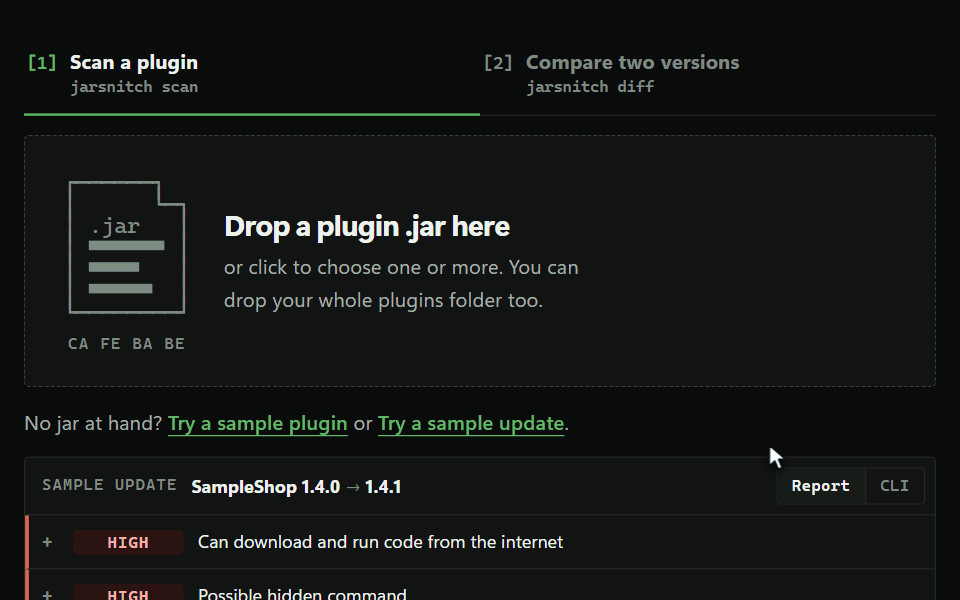
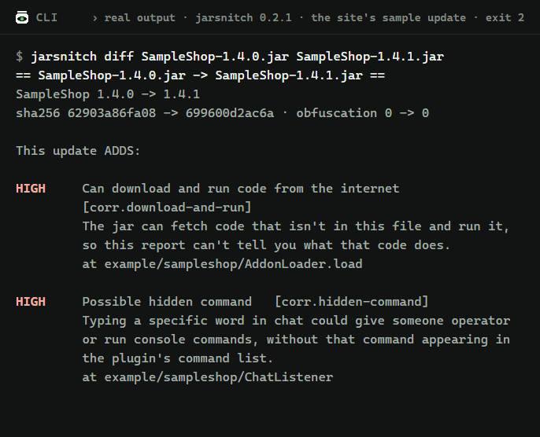

# jarsnitch

See what a Minecraft plugin can do before you install it.

> **Try it in your browser:** https://jarsnitch.mbaconz.workers.dev. The page reads the jar on your machine; nothing is uploaded.

<picture><source media="(prefers-reduced-motion: reduce)" srcset="https://raw.githubusercontent.com/mattbaconz/jarsnitch/main/docs/media/site-compare.png"></picture>

jarsnitch reads a plugin `.jar` (Bukkit, Spigot, Paper, Folia, Velocity, BungeeCord) and tells you in plain English what its code is able to do: run commands on your machine, download and run new code, give players operator, send data to a Discord webhook. Each finding says where in the code it was found and why it matters.

It reads the bytecode. It never loads or runs the plugin.

## Two ways to use it

**Website.** Drop one jar to scan it, two versions of a plugin to compare them, or your whole plugins folder to scan every jar in it. No jar at hand? The page has a sample plugin and a sample update to try. The analysis runs in your browser (WebAssembly). Your files never leave your machine: no upload, no backend, no telemetry. Once the page has loaded it needs no network at all.

**Command line.**

```bash
jarsnitch scan MyPlugin.jar
```

```bash
jarsnitch scan plugins/
```

```bash
jarsnitch diff MyPlugin-1.4.jar MyPlugin-1.5.jar
```

## Check an update before you install it

A plugin you already trust can change in an update: a new owner, a compromised author account, a "fixed" re-upload from an unofficial site. `diff` compares two versions and leads with what the new one adds.

<picture><source media="(prefers-reduced-motion: reduce)" srcset="https://raw.githubusercontent.com/mattbaconz/jarsnitch/main/docs/media/cli-diff.png"></picture>

```text
$ jarsnitch diff SampleShop-1.4.0.jar SampleShop-1.4.1.jar
== SampleShop-1.4.0.jar -> SampleShop-1.4.1.jar ==
SampleShop 1.4.0 -> 1.4.1
sha256 62903a86fa08 -> 699600d2ac6a · obfuscation 0 -> 0

This update ADDS:

HIGH     Can download and run code from the internet   [corr.download-and-run]
         The jar can fetch code that isn't in this file and run it, so this report can't tell you what that code does.
         at example/sampleshop/AddonLoader.load

HIGH     Possible hidden command   [corr.hidden-command]
         Typing a specific word in chat could give someone operator or run console commands, without that command appearing in the plugin's command list.
         at example/sampleshop/ChatListener

HIGH     New class: example/sampleshop/AddonLoader   [code.load, corr.download-and-run, fs.write-archive]

HIGH     New class: example/sampleshop/ChatListener   [corr.hidden-command, mc.set-op]

NOTABLE  Can load new code while running   [code.load]
         Code that isn't in this jar can be added later, and jarsnitch can only judge what's in the file.
         at example/sampleshop/AddonLoader.load

NOTABLE  Can write .jar or .class files   [fs.write-archive]
         Writing jar or class files is how code installs or changes plugins, including other plugins.
         at example/sampleshop/AddonLoader.load

NOTABLE  Can give players operator   [mc.set-op]
         An operator can run every command on the server.
         at example/sampleshop/ChatListener.onChat

INFO     Contains web addresses: cdn.example.invalid   [str.url]
         These are hosts the plugin may contact. Unfamiliar ones are worth a look.
         at example/sampleshop/AddonLoader.load

INFO     Contains web addresses: shop-plugins.example.net   [str.url]
         These are hosts the plugin may contact. Unfamiliar ones are worth a look.
         at plugin.yml

This update REMOVES:

INFO     Contains web addresses: sampleshop.example.com   [str.url]
         These are hosts the plugin may contact. Unfamiliar ones are worth a look.
         at plugin.yml

Changes:
  plugin.yml authors: ExampleDev -> ExampleNewOwner
  plugin.yml version: 1.4.0 -> 1.4.1
  plugin.yml website: https://sampleshop.example.com -> https://shop-plugins.example.net
A different author or website can mean the plugin has a new owner.

Unchanged: mc.console-command, net.http, net.socket, str.url

This shows what the code can do, not proof of what it will do. A clean report isn't a guarantee.
```

*(Real output, exit code 2, for the website's sample update in `web/samples/`. SampleShop is a made-up plugin.)*

Findings are matched by rule and value (host, webhook id, path), not by where they sit, so a finding whose code only moved stays unchanged. A capability the old version already had counts as unchanged even if it now appears in more places. Classes are compared by name: a new class that carries notable or High evidence is listed as new, so code moved into a renamed class shows up there.

`diff` also lists what changed around the code: new classes with notable or High evidence, commands, permissions, plugin dependencies, downloaded and bundled libraries, and the plugin's name, version, main class, authors and website. A different author or website can mean the plugin has a new owner.

## What a finding tells you

- **Severity:** info, notable or high. See [severities](https://jarsnitch.mbaconz.workers.dev/docs/rules/#severities).
- **Title** in plain English, for example "Can give players operator".
- **Why it matters**, in one line.
- **Typical legitimate uses**, because most capabilities have them (on the website and in `--json` output).
- **Where:** class and method, with nested jars shown as `libs/helper.jar!/com/example/Net`.
- **Not called**, when nothing the plugin starts from (its main class, event handlers, commands, service files) calls that code. Scans list these findings last.

High is used for combinations that give a jar a lot of control (for example network access plus runtime code loading) and for bundled libraries with known security bugs.

## What it looks for

Every rule jarsnitch applies. Rule ids never change, so you can filter on them in `--json` output.

| Rule | Severity | Finding |
|---|---|---|
| `exec.process` | notable | Can run commands on your server's operating system |
| `code.load` | notable | Can load new code while running |
| `code.instrument` | notable | Can change other code as it loads |
| `code.native` | notable | Can load native (non-Java) code |
| `net.http` | info | Can connect to websites |
| `net.socket` | notable | Can open raw network connections |
| `mc.set-op` | notable | Can give players operator |
| `mc.console-command` | info | Can run server commands |
| `fs.write-archive` | notable | Can write .jar or .class files |
| `reflect.indirect` | notable | Reaches a powerful feature through reflection |
| `deser.java` | notable | Reads Java serialized objects |
| `script.engine` | notable | Can run scripts |
| `proc.exit` | notable | Can shut the server down instantly |
| `str.url` | info | Contains web addresses |
| `str.ip` | notable | Contains a hardcoded IP address |
| `str.discord-webhook` | notable | Can send data to a Discord webhook |
| `str.telegram-bot` | notable | Can send data to a Telegram bot |
| `str.hidden-text` | notable | Contains text hidden from simple searches |
| `str.login-file` | notable | Contains the path of a password or login file |
| `blob.embedded-code` | notable | Contains hidden embedded code |
| `res.type-mismatch` | notable | A file's contents don't match its name |
| `jar.nested` | info | Bundles other archives |
| `jar.unsafe-path` | notable | Archive has file paths that point outside it |
| `meta.missing-main` | notable | The declared main class is missing |
| `meta.no-descriptor` | info | Not a recognized plugin |
| `lib.log4j-vulnerable` | high | Bundles a log4j version with known security bugs |
| `obf.score` | info | Code is obfuscated |
| `corr.download-and-run` | high | Can download and run code from the internet |
| `corr.hidden-command` | high | Possible hidden command |
| `corr.modify-plugins` | high | Can modify other plugins |
| `corr.command-and-network` | high | Can run operating-system commands and connect to the internet |
| `corr.login-files-and-network` | high | Names password or login files and can connect to the internet |
| `corr.hidden-loader` | high | Contains hidden code and can load it |

`corr.*` rules are combinations: they fire when the parts they list appear together in one class (`corr.hidden-loader`: anywhere in the jar). The three network combinations also fire when the parts sit in other classes but one method calls them directly. What triggers each rule, its legitimate uses and its exact limits: [the rules page](https://jarsnitch.mbaconz.workers.dev/docs/rules/).

## How to read a report

- **"Can" means the code is in the jar, not that it runs.** jarsnitch follows calls from the plugin's entry points: the main class, the methods the server calls on it, event handlers, and classes named in the manifest, service files or configs. A finding in code nothing there calls, often an unused part of a bundled library, is marked "not called", and scans list it last. Its severity doesn't change.
- **"Not called" is an estimate.** Code reached only through reflection, or from code the plugin loads at runtime, can still run. When the plugin loads code at runtime, the report says so.
- **Most findings have ordinary explanations.** Paid plugins often obfuscate their code and contact a license server. Reward plugins run console commands from their config. Dependency loaders download libraries at startup. Ask whether a finding fits what the plugin says it does.
- **jarsnitch never calls a plugin malware, safe or clean.** It reports facts and leaves the judgement to you.

Every report ends with:

> This shows what the code can do, not proof of what it will do. A clean report isn't a guarantee.

## What it can't catch

- **Code that isn't in the jar.** Anything downloaded or generated at runtime is invisible. You'll see that the jar *can* load code, not what it loads.
- **Text built at runtime.** jarsnitch reads string literals, text written as constant byte or char arrays, and base64 or hex. Addresses and class names assembled, decrypted or downloaded at runtime stay hidden.
- **Encrypted payloads.** XOR, AES or custom encoding isn't decoded; it may only show up as a higher obfuscation score.
- **Intent.** A legitimate updater and a malicious dropper can use exactly the same calls.
- **Combinations spread further.** The High findings for network access plus code loading, OS commands or login files need both parts in one class, or in one method and the methods it calls directly. Parts joined through longer call chains, fields or callbacks are each listed on their own.
- **Exact reachability.** The call graph assumes that every method the server could call on a plugin class runs, and it can't follow names built at runtime, so "not called" isn't proof that the code never runs.
- **Known malware by name.** jarsnitch ships no malware signatures. It won't tell you "this is family X".
- **Non-Java code in resources.** Scripts (Skript, JavaScript) and native libraries inside the jar are not analyzed, though disguised ones are flagged.
- **Mods.** Fabric, Quilt, Forge and NeoForge jars get their name and version read and the same bytecode rules, but no mod-specific checks.
- **Exotic archive tricks.** jarsnitch reads the zip central directory the way the JVM does. Archives built to look different to different readers may still fool it.
- **Very large or hostile archives.** Scans stop at size and count limits. The report is then marked partial, and a partial report is not a clean one.

## Command line reference

```text
jarsnitch scan <jar|folder>... [--json]
jarsnitch diff <old.jar> <new.jar> [--json]
jarsnitch --version
jarsnitch --help
```

- `scan` on a folder scans every `.jar` directly inside it (not subfolders).
- `--json` prints the full report. `scan` prints a JSON array with one report per jar; `diff` prints one object. See [the JSON format](https://jarsnitch.mbaconz.workers.dev/docs/json/).

Exit codes:

| Code | `scan` | `diff` |
|---|---|---|
| 0 | No High findings | The update adds no High findings |
| 1 | A file couldn't be read or isn't a zip, or there was nothing to scan (and no High findings) | Either file couldn't be read |
| 2 | At least one High finding | The update adds at least one High finding |

Use exit code 2 to fail a CI job or an update script.

## Install

Prebuilt binaries for Windows, macOS and Linux are on the [releases page](https://github.com/mattbaconz/jarsnitch/releases/latest). Or use the install script for your system:

```bash
curl --proto '=https' --tlsv1.2 -LsSf https://github.com/mattbaconz/jarsnitch/releases/latest/download/jarsnitch-installer.sh | sh
```

```powershell
powershell -ExecutionPolicy Bypass -c "irm https://github.com/mattbaconz/jarsnitch/releases/latest/download/jarsnitch-installer.ps1 | iex"
```

With Rust stable:

```bash
cargo install jarsnitch
```

From a checkout: `cargo install --path crates/cli`.

### Run the website yourself

The website, built locally (needs the wasm32 target: `rustup target add wasm32-unknown-unknown`):

```bash
./scripts/build-web.sh
```

```bash
python -m http.server 8080 -d web
```

Then open http://localhost:8080. On Windows, run `scripts\build-web.ps1` instead of the first command. `web/` is a plain static site; any static host works. Send the headers in `web/_headers` if your host supports them.

## Similar tools

- [PluginGuard](https://github.com/denfry/PluginGuard): server-side analyzer you upload jars to, with an optional sandbox, signature matching and install recommendations.
- [PluginScan](https://github.com/Rikonardo/PluginScan): web and JVM CLI scanner with community-written checks.

jarsnitch focuses on comparing versions, runs entirely on your machine, and reports capabilities instead of verdicts.

## Docs

The full documentation is on the website: [getting started](https://jarsnitch.mbaconz.workers.dev/docs/start/), [scanning](https://jarsnitch.mbaconz.workers.dev/docs/scan/), [comparing versions](https://jarsnitch.mbaconz.workers.dev/docs/compare/), [reading a report](https://jarsnitch.mbaconz.workers.dev/docs/report/), [the call graph](https://jarsnitch.mbaconz.workers.dev/docs/call-graph/), the [command line](https://jarsnitch.mbaconz.workers.dev/docs/cli/) and [JSON format](https://jarsnitch.mbaconz.workers.dev/docs/json/), [privacy](https://jarsnitch.mbaconz.workers.dev/docs/privacy/) and an [FAQ](https://jarsnitch.mbaconz.workers.dev/docs/faq/). Its sources are in [docs/guide](https://github.com/mattbaconz/jarsnitch/blob/main/docs/guide). In this repository:

- [Rules](https://github.com/mattbaconz/jarsnitch/blob/main/docs/rules.md): every rule, what triggers it, typical legitimate uses ([on the website](https://jarsnitch.mbaconz.workers.dev/docs/rules/))
- [Architecture](https://github.com/mattbaconz/jarsnitch/blob/main/docs/architecture.md): crates, report format, diff, limits, web app ([on the website](https://jarsnitch.mbaconz.workers.dev/docs/how-it-works/))
- [Benchmarks](https://github.com/mattbaconz/jarsnitch/blob/main/docs/benchmarks.md): speed and findings on Modrinth's 100 most-downloaded plugins ([on the website](https://jarsnitch.mbaconz.workers.dev/docs/benchmarks/))
- [Contributing](https://github.com/mattbaconz/jarsnitch/blob/main/CONTRIBUTING.md): adding a rule, fixtures, tests

## License

Licensed under either of [MIT](https://github.com/mattbaconz/jarsnitch/blob/main/LICENSE-MIT) or [Apache-2.0](https://github.com/mattbaconz/jarsnitch/blob/main/LICENSE-APACHE), at your option.
